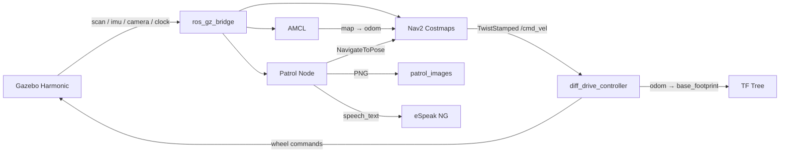

# 基于 ROS 2 和 Navigation2 的自主巡检机器人

本项目是在 ROS 2 Jazzy 与 Gazebo Harmonic 环境中实现的差速轮式机器人仿真。机器人使用 `ros2_control` 驱动，通过激光雷达和 Nav2 完成定位、路径规划与避障，并可按照预设巡逻点循环导航、中文语音播报和保存相机图像。

## 功能

- 在 Gazebo Harmonic 中加载 FishBot、房间地图和室内障碍物
- 使用 `gz_ros2_control` 和 `diff_drive_controller` 控制左右车轮
- 桥接仿真时钟、激光雷达、IMU、RGB-D 相机及点云数据
- 使用 AMCL 在已知地图中定位
- 使用 Nav2 完成规划、控制、速度平滑和碰撞监测
- 在 RViz 中设置初始位姿和导航目标点
- 使用 `nav2_simple_commander` 编写导航示例
- 按预设目标点循环巡逻
- 到达巡逻点后进行中文语音播报并保存相机图像

## 运行环境

本项目当前使用以下环境开发和验证：

- Ubuntu 24.04（WSL 2）
- ROS 2 Jazzy
- Gazebo Harmonic / Gazebo Sim 8
- Navigation2
- Python 3.12

工作空间默认位置为：

```text
/home/overlume/ros2_learn/ros_autopatrol_fishbot/ros_autopatrol_fishbot_ws
```

如果将项目移动到其他目录，需要同步修改 [`autopatrol_robot/config/patrol_config.yaml`](ros_autopatrol_fishbot_ws/src/autopatrol_robot/config/patrol_config.yaml) 中的 `image_save_path`。

## 系统数据流



主要 TF 链路为：

```text
map -> odom -> base_footprint -> base_link -> laser/camera/imu/wheels
```

- `map -> odom`：由 AMCL 发布
- `odom -> base_footprint`：由 `diff_drive_controller` 发布
- 机器人本体及传感器的静态/动态变换：由 `robot_state_publisher` 发布

## 功能包结构

| 功能包 | 作用 |
| --- | --- |
| `fishbot_description` | FishBot 的 URDF/Xacro、Gazebo 世界、传感器、`ros2_control` 配置和 Gazebo 启动文件 |
| `fishbot_navigation2` | 地图、Nav2 参数、AMCL 与 RViz 导航启动文件 |
| `fishbot_application` | 初始化位姿、读取机器人位姿、导航到单个目标点的 Python 示例 |
| `autopatrol_interfaces` | 中文语音播报服务 `SpeachText.srv` |
| `autopatrol_robot` | 自动巡逻、语音播报和相机图像保存 |

关键文件：

```text
ros_autopatrol_fishbot/
├── README.md
├── .gitignore
└── ros_autopatrol_fishbot_ws/
    └── src/
        ├── autopatrol_interfaces/
        │   └── srv/SpeachText.srv
        ├── autopatrol_robot/
        │   ├── autopatrol_robot/patrol_node.py
        │   ├── autopatrol_robot/speaker.py
        │   ├── config/patrol_config.yaml
        │   └── launch/autopatrol.launch.py
        ├── fishbot_application/
        │   └── fishbot_application/
        │       ├── get_robot_pose.py
        │       ├── init_robot_pose.py
        │       └── nav_to_pose.py
        ├── fishbot_description/
        │   ├── config/fishbot_ros2_controller.yaml
        │   ├── launch/gazebo_sim.launch.py
        │   ├── urdf/fishbot/
        │   └── world/custom_room.sdf
        └── fishbot_navigation2/
            ├── config/nav2_params.yaml
            ├── launch/navigation.launch.py
            └── maps/
                ├── room.pgm
                └── room.yaml
```

## 安装依赖

先确保已经正确安装 ROS 2 Jazzy，然后安装项目使用的主要软件包：

```bash
sudo apt update
sudo apt install \
  ros-jazzy-desktop \
  ros-jazzy-ros-gz \
  ros-jazzy-gz-ros2-control \
  ros-jazzy-ros2-control \
  ros-jazzy-ros2-controllers \
  ros-jazzy-navigation2 \
  ros-jazzy-nav2-bringup \
  ros-jazzy-teleop-twist-keyboard \
  ros-jazzy-cv-bridge \
  ros-jazzy-tf-transformations \
  python3-opencv \
  python3-pip \
  espeak-ng
```

自动巡逻的语音节点还需要 Python `espeakng` 模块。可以先检查：

```bash
python3 -c "import espeakng; print(espeakng.__file__)"
```

如果提示模块不存在，可安装到当前用户目录：

```bash
python3 -m pip install --user --break-system-packages espeakng
```

> WSL 中能否实际播放声音取决于 WSLg/PulseAudio 是否可用。声音不可用不会影响 Gazebo、Nav2 和图像保存逻辑，但语音服务可能会报音频设备错误。

## 构建项目

```bash
cd /home/overlume/ros2_learn/ros_autopatrol_fishbot/ros_autopatrol_fishbot_ws
source /opt/ros/jazzy/setup.bash
rosdep install --from-paths src --ignore-src -r -y
colcon build --symlink-install
source install/setup.bash
```

每个新终端都需要加载 ROS 2 和当前工作空间：

```bash
source /opt/ros/jazzy/setup.bash
source /home/overlume/ros2_learn/ros_autopatrol_fishbot/ros_autopatrol_fishbot_ws/install/setup.bash
```

修改 Python、YAML、URDF 或 Launch 文件后，建议重新构建并重新加载环境：

```bash
cd /home/overlume/ros2_learn/ros_autopatrol_fishbot/ros_autopatrol_fishbot_ws
colcon build --symlink-install
source install/setup.bash
```

## 启动 Gazebo 仿真

在终端 1 中执行：

```bash
source /opt/ros/jazzy/setup.bash
source /home/overlume/ros2_learn/ros_autopatrol_fishbot/ros_autopatrol_fishbot_ws/install/setup.bash
ros2 launch fishbot_description gazebo_sim.launch.py
```

启动文件会自动完成以下操作：

1. 启动 Gazebo 并加载 `custom_room.sdf`
2. 发布机器人描述并将 FishBot 加入世界
3. 启动 Gazebo 到 ROS 2 的传感器桥接
4. 激活 `fishbot_joint_state_broadcaster`
5. 激活 `fishbot_diff_drive_controller`

可以检查控制器状态：

```bash
ros2 control list_controllers
```

正常情况下应看到两个控制器均为 `active`。

## 键盘控制

ROS 2 Jazzy 的 `diff_drive_controller` 接收 `geometry_msgs/msg/TwistStamped`。因此键盘节点必须启用 `stamped` 参数：

```bash
source /opt/ros/jazzy/setup.bash
source /home/overlume/ros2_learn/ros_autopatrol_fishbot/ros_autopatrol_fishbot_ws/install/setup.bash
ros2 run teleop_twist_keyboard teleop_twist_keyboard \
  --ros-args -p stamped:=true
```

常用按键：

- `i`：前进
- `,`：后退
- `j` / `l`：左转 / 右转
- `k`：停止

检查 `/cmd_vel` 的消息类型和连接关系：

```bash
ros2 topic info /cmd_vel -v
```

> 不要在 Nav2 正在控制机器人时同时运行键盘控制，否则两个节点会同时向 `/cmd_vel` 发布速度指令。

## 启动 Nav2

保持 Gazebo 运行，在终端 2 中执行：

```bash
source /opt/ros/jazzy/setup.bash
source /home/overlume/ros2_learn/ros_autopatrol_fishbot/ros_autopatrol_fishbot_ws/install/setup.bash
ros2 launch fishbot_navigation2 navigation.launch.py
```

启动后必须设置机器人初始位姿，否则 AMCL 不会建立 `map -> odom`，Nav2 可能一直等待代价地图或 TF。

### 方法一：在 RViz 中设置初始位姿

1. 将 RViz 的 `Fixed Frame` 设置为 `map`
2. 点击工具栏中的 **2D Pose Estimate**
3. 在地图原点附近按住鼠标并拖动，指定机器人朝向
4. 等待地图、激光数据和机器人模型正常显示

### 方法二：运行初始化节点

在终端 3 中执行：

```bash
source /opt/ros/jazzy/setup.bash
source /home/overlume/ros2_learn/ros_autopatrol_fishbot/ros_autopatrol_fishbot_ws/install/setup.bash
ros2 run fishbot_application init_robot_pose
```

该节点将初始位姿设为 `(0.0, 0.0, 0.0)`，并等待 Nav2 激活。建议在启动 Nav2 后立即设置初始位姿，不要长时间等待，否则导航生命周期管理器可能因 `map -> odom` 缺失而激活超时。

### 发送导航目标

在 RViz 中点击 **Nav2 Goal** 或 **2D Goal Pose**，然后在地图空闲区域设置目标位置和朝向。Nav2 会生成路径并控制机器人前往目标点。

也可以运行项目中的固定目标点示例，默认目标为 `(1.0, 1.0)`：

```bash
ros2 run fishbot_application nav_to_pose
```

查看机器人当前在 `map` 坐标系下的位置：

```bash
ros2 run fishbot_application get_robot_pose
```

## 启动自主巡逻

先启动 Gazebo 和 Nav2，然后在新终端中执行：

```bash
source /opt/ros/jazzy/setup.bash
source /home/overlume/ros2_learn/ros_autopatrol_fishbot/ros_autopatrol_fishbot_ws/install/setup.bash
ros2 launch autopatrol_robot autopatrol.launch.py
```

巡逻节点会：

1. 根据配置发送机器人初始位姿
2. 等待 AMCL 和 Nav2 激活
3. 依次导航到配置的目标点
4. 到达后通过 eSpeak NG 播报状态
5. 从 `/camera/image` 获取最新图像
6. 以当前位置命名并保存 PNG 文件
7. 完成全部目标点后重新开始循环巡逻

巡逻图片保存在：

```text
/home/overlume/ros2_learn/ros_autopatrol_fishbot/ros_autopatrol_fishbot_ws/patrol_images
```

查找已保存图片：

```bash
find /home/overlume/ros2_learn/ros_autopatrol_fishbot/ros_autopatrol_fishbot_ws/patrol_images \
  -maxdepth 1 -type f -name 'image_*.png'
```

成功保存时会输出完整路径，例如：

```text
图像已保存: /home/overlume/ros2_learn/ros_autopatrol_fishbot/ros_autopatrol_fishbot_ws/patrol_images/image_0.00_0.00.png
```

图片文件名由保存时的机器人位置生成。如果机器人多次在完全相同的位置记录图像，后一次图片会覆盖同名文件。

## 修改巡逻点

巡逻配置位于 [`autopatrol_robot/config/patrol_config.yaml`](ros_autopatrol_fishbot_ws/src/autopatrol_robot/config/patrol_config.yaml)。每三个数值组成一个目标点：

```yaml
target_points: [
  x1, y1, yaw1,
  x2, y2, yaw2,
]
```

- `x`、`y`：目标点在 `map` 坐标系中的位置，单位为米
- `yaw`：目标朝向，单位为弧度

当前配置示例：

```yaml
patrol_node:
  ros__parameters:
    initial_point: [0.0, 0.0, 0.0]
    image_topic: "/camera/image"
    image_save_path: "~/ros2_learn/ros_autopatrol_fishbot/ros_autopatrol_fishbot_ws/patrol_images"
    target_points: [
      0.0, 0.0, 0.0,
      1.0, 2.0, 3.14,
      -4.5, 1.5, 1.57,
      -8.0, -5.0, 1.57,
      1.0, -5.0, 3.14,
    ]
```

修改后重新构建：

```bash
cd /home/overlume/ros2_learn/ros_autopatrol_fishbot/ros_autopatrol_fishbot_ws
colcon build --packages-select autopatrol_robot --symlink-install
source install/setup.bash
```

## 主要话题

| 话题 | 类型 | 来源/用途 |
| --- | --- | --- |
| `/clock` | `rosgraph_msgs/msg/Clock` | Gazebo 仿真时间 |
| `/scan` | `sensor_msgs/msg/LaserScan` | 激光雷达，供 AMCL、代价地图和碰撞监测使用 |
| `/imu` | `sensor_msgs/msg/Imu` | IMU 数据 |
| `/camera/image` | `sensor_msgs/msg/Image` | RGB 相机图像，供巡逻节点保存图片 |
| `/camera/camera_info` | `sensor_msgs/msg/CameraInfo` | 相机内参 |
| `/camera/depth_image` | `sensor_msgs/msg/Image` | 深度图像 |
| `/camera/points` | `sensor_msgs/msg/PointCloud2` | RGB-D 点云 |
| `/cmd_vel` | `geometry_msgs/msg/TwistStamped` | 键盘或 Nav2 输出的速度指令 |
| `/odom` | `nav_msgs/msg/Odometry` | 差速控制器输出的里程计 |
| `/joint_states` | `sensor_msgs/msg/JointState` | 车轮关节状态 |
| `/amcl_pose` | `geometry_msgs/msg/PoseWithCovarianceStamped` | AMCL 估计的机器人位姿 |
| `/tf`、`/tf_static` | `tf2_msgs/msg/TFMessage` | 坐标系变换 |

相机和点云使用 lazy bridge：只有 ROS 2 侧存在订阅者时，Gazebo 桥才会转换这些大数据话题。

## 常用检查命令

```bash
# 查看节点和话题
ros2 node list
ros2 topic list

# 检查控制器
ros2 control list_controllers

# 检查速度话题的消息类型、发布者和订阅者
ros2 topic info /cmd_vel -v

# 检查相机连接和 QoS
ros2 topic info /camera/image -v

# 使用传感器 QoS 接收一帧相机图像
ros2 topic echo /camera/image --once --qos-reliability best_effort

# 查看 AMCL 状态
ros2 lifecycle get /amcl

# 检查 TF
ros2 run tf2_ros tf2_echo map odom
ros2 run tf2_ros tf2_echo odom base_footprint

# 检查里程计频率
ros2 topic hz /odom
```

## 常见问题

### 1. 键盘节点运行了，但机器人不移动

Jazzy 中的 `diff_drive_controller` 使用 `TwistStamped`。请使用：

```bash
ros2 run teleop_twist_keyboard teleop_twist_keyboard \
  --ros-args -p stamped:=true
```

并使用 `ros2 control list_controllers` 确认差速控制器为 `active`。

### 2. RViz 中没有 `map` 或 `odom`，RobotModel 报错

依次检查：

```bash
ros2 topic echo /odom --once
ros2 topic echo /joint_states --once
ros2 run tf2_ros tf2_echo odom base_footprint
ros2 run tf2_ros tf2_echo map odom
```

如果只有 Gazebo、尚未启动 Nav2，RViz 的固定坐标系可使用 `odom`。启动 Nav2 并完成 AMCL 初始化后，应使用 `map`。

### 3. 一直显示等待 AMCL，代价地图无法加载

AMCL 必须收到初始位姿后才能发布 `map -> odom`。请在 Nav2 启动后立即执行：

```bash
ros2 run fishbot_application init_robot_pose
```

或者在 RViz 中使用 **2D Pose Estimate**。同时确认 `/scan` 有数据且 AMCL 使用兼容的传感器 QoS：

```bash
ros2 topic info /scan -v
ros2 topic echo /scan --once --qos-reliability best_effort
```

### 4. 终端显示图像记录完成，但找不到图片

当前程序只会在 `cv2.imwrite()` 真正成功后输出“图像记录完成”，并会打印完整保存路径。检查：

```bash
ros2 topic info /camera/image -v
find /home/overlume/ros2_learn/ros_autopatrol_fishbot/ros_autopatrol_fishbot_ws/patrol_images \
  -maxdepth 1 -type f -name 'image_*.png'
```

相机话题使用 `BEST_EFFORT` QoS，订阅时应使用传感器数据 QoS。

### 5. 咖啡桌显示为长方体或提示 `cafe_table.dae` 找不到

世界文件通过 `model://cafe_table/meshes/cafe_table.dae` 加载桌子网格。确认本地模型资源存在：

```bash
find ~/.gazebo/models/cafe_table -maxdepth 3 -type f
```

至少应包含：

```text
~/.gazebo/models/cafe_table/model.config
~/.gazebo/models/cafe_table/model.sdf
~/.gazebo/models/cafe_table/meshes/cafe_table.dae
```

`gazebo_sim.launch.py` 会自动把 `~/.gazebo/models` 和咖啡桌资源目录加入 `GZ_SIM_RESOURCE_PATH`。

### 6. RViz 卡顿或界面仍在计时但无法操作

相机、深度图和点云数据量较大。没有使用时不要在 RViz 中同时添加全部传感器显示；可以先只保留地图、LaserScan、RobotModel、TF 和规划路径。WSL 图形加速异常时也可以尝试重新启动 WSLg 或降低 Gazebo/RViz 的渲染负载。

## 停止程序

在各终端按 `Ctrl+C`，建议按照以下顺序停止：

1. 自主巡逻或键盘控制
2. Nav2 / RViz
3. Gazebo

如果异常退出后仍有节点残留，可以先检查：

```bash
ros2 node list
pgrep -af 'gz sim|rviz2|nav2|patrol_node'
```

## License

各功能包当前使用 Apache-2.0 License，详见对应功能包中的 `LICENSE` 文件。
